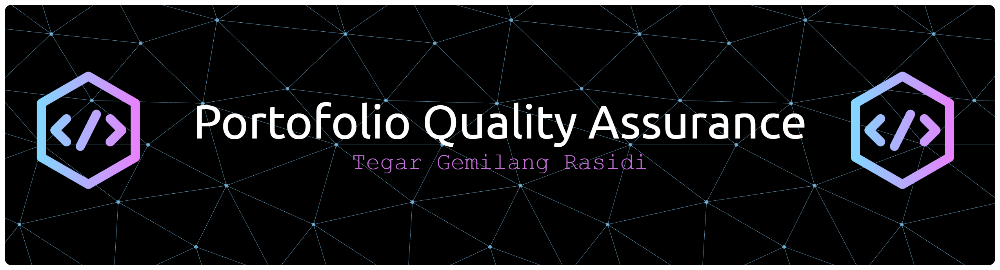

<!--
**tegargr28/tegargr28** is a ✨ _special_ ✨ repository because its `README.md` (this file) appears on your GitHub profile.

Here are some ideas to get you started:

- 🔭 I’m currently working on ...
- 🌱 I’m currently learning ...
- 👯 I’m looking to collaborate on ...
- 🤔 I’m looking for help with ...
- 💬 Ask me about ...
- 📫 How to reach me: ...
- 😄 Pronouns: ...
- ⚡ Fun fact: ...
-->
- 🌱 I am developing my skills in Quality Assurance through self-directed learning and hands-on practice. I have gained knowledge of manual testing, organizing test cases using Google Sheets, and documenting bugs with clear reproduction steps, expected and actual results, and supporting evidence such as screenshots or videos. I am continuously improving my understanding of software testing and eager to contribute to a QA team by ensuring software quality through careful, structured, and detail-oriented testing.
